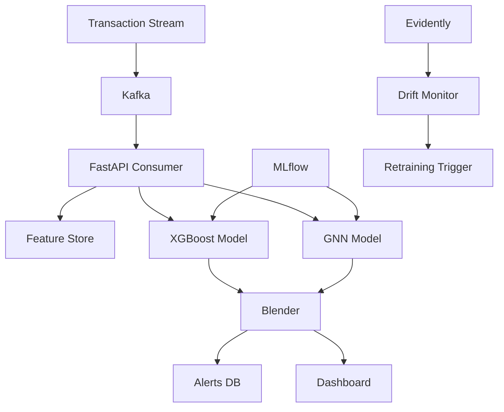

# Architecture

## System Overview

## Components

### Data Layer
- **Kafka**: Real-time transaction streaming
- **Feature Store**: Parquet offline + SQLite online
- **Alerts DB**: SQLite for storing fraud cases

### ML Layer
- **XGBoost**: Gradient boosting for tabular features
- **GNN**: Graph neural network for relationship patterns
- **Blender**: Meta-learner to combine predictions
- **MLflow**: Experiment tracking and model registry

### Monitoring Layer
- **Evidently**: Data and prediction drift detection
- **Retraining Job**: CronJob to trigger model updates

### API Layer
- **FastAPI**: Scoring service with /score, /health, /metrics endpoints
- **Streamlit**: Analyst dashboard for case review

## Data Flow

1. Transactions flow into Kafka topic
2. Consumer fetches online features from Feast
3. Models score transactions in parallel
4. Blender combines scores
5. High-risk transactions saved to alerts DB
6. Dashboard displays cases for analyst review
7. Analyst feedback exported for retraining
8. Drift monitor checks for distribution shifts
9. Retraining triggered if drift exceeds threshold
